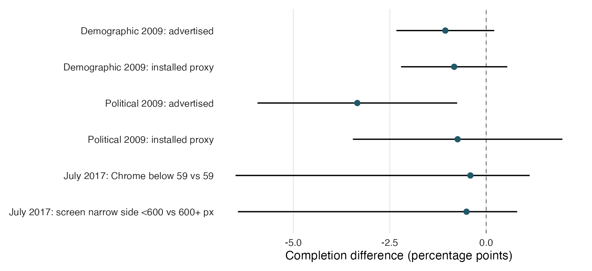

## “Poor” Browsers and Internet Surveys

Gaurav Sood

What can routinely collected browser and device metadata tell survey
organizations about participation, answer provision, and sample composition?
This project evaluates descriptive signals and distinguishes them from evidence
for forecasting or changing survey delivery.

The original July 31, 2011 note was cited in Callegaro’s 2013 chapter on web
survey paradata. The [literature review](docs/literature.md) documents that history
and relates the extension to subsequent work.

Read the [research note](ms/main.pdf). The manuscript and analysis follow the
same questions:

1. **Why examine technical paradata?** Define the practical uses and each study's contribution.
2. **What does the signal measure?** Establish technical definitions, outcome denominators, and assumptions.
3. **Where does it identify differences?** Compare completion, recorded answers, and elapsed time.
4. **Does it add useful information?** Distinguish descriptive associations from added predictive value.
5. **What could a survey organization do with it?** Connect findings to diagnosis, forecasting, delivery, and composition monitoring.

The historical political-survey completion association changes substantially
when Internet Explorer compatibility settings are reclassified. July 2017
comparisons by desktop Chrome recency and recorded resolution are imprecise.
March narrative responses are shorter in the mobile-OS group; browser-family
comparisons also reflect device composition. Additional surveys show different
elapsed-time patterns. July slider blanks
include explicit “Not Applicable” selections and cannot be read as item
nonresponse. Current local data do not support the proposed panel forecasting
or intervention analyses; these are specified external-data extensions.

<p align="center">
  
</p>

### Analysis and repository

| Location | Role |
|---|---|
| `docs/analysis_plan.md` | Retrospective specifications, prior result exposure, and external-data design |
| `docs/measurements.csv` | Constructs, measures, denominators, assumptions, and interpretation |
| `docs/exposure_items.csv` | Explicit 2017 item-to-timer mappings |
| `docs/access.csv` | Computed versus pending data contributions |
| `docs/external_access.md` | Download attempts, exact source files, and remaining access requirements |
| `docs/ui_testing.md` | Compatibility checks, task-based usability study, and randomized repair test |
| `R/` | Shared imports, technical measures, estimates, and exhibit helpers |
| `scripts/import_signals.R` | Optional source imports and aggregate snapshots |
| `scripts/questions.R` | Analysis outputs organized by the manuscript's questions |
| `scripts/question_exhibits.R` | Shared result tables, figure, and manuscript macros |
| `data/raw/` | Historical analysis file and provenance |
| `data/validation/` | Aggregate source snapshots, hashes, overlap checks, and metadata coverage |
| `tabs/study_years.csv` | Fieldwork years and dates; unknown dates are explicit |
| `tabs/q*` | Question-organized results, including explicit unavailable-analysis statuses |
| `ms/` | Main note, historical appendix, bibliography, and compiled PDF |
| `tests/testthat/` | Denominator, parsing, sparse-inference, and regression checks |
| `archive/` | Original writing and code |

The [additional-data review](docs/additional_data.md) describes accessible and
restricted sources. The [audit record](docs/audit.md) preserves historical
corrections and the new source checks. Exact file copies and repeated item rows
are not treated as independent surveys or respondents.

### Reproduce the note

```sh
make restore
make check
```

This uses R packages pinned in `renv.lock`, XeLaTeX, and `latexmk`. It rebuilds
historical and question-organized analyses, figures, tables, and the manuscript,
then runs lint, tests, and simulations. All reported numerical findings use
generated tables and macros. `make format` applies styler. `make ci-docker`
runs checks with the standard `rocker/r-ver:4.6.0` image and a running Docker daemon.

The normal build consumes saved aggregate snapshots and does not require sibling
repositories or account-gated downloads. To regenerate the snapshots from the
authorized local source files:

```sh
mkdir -p tmp
curl -L --fail 'https://www.jstatsoft.org/article/download/v092c01/3903' -o tmp/parseuas.dta
JSS_UA_SOURCE=tmp/parseuas.dta make import-signals
make check
```

Set `SOURCE_ROOT` if the sibling repositories are located elsewhere. Source
imports keep respondent records and identifiers in memory and write only
aggregate outputs. `make validate-sources` repeats the original SPSS linkage
checks; `make validate-extensions` repeats the broader export inventory.

CRONOS, Digitize!, and GESIS microdata remain access-dependent. Their intended
analyses and required inputs are explicit in the plan and access ledger. No
predictions, composition corrections, or intervention effects are substituted
for those pending analyses.
